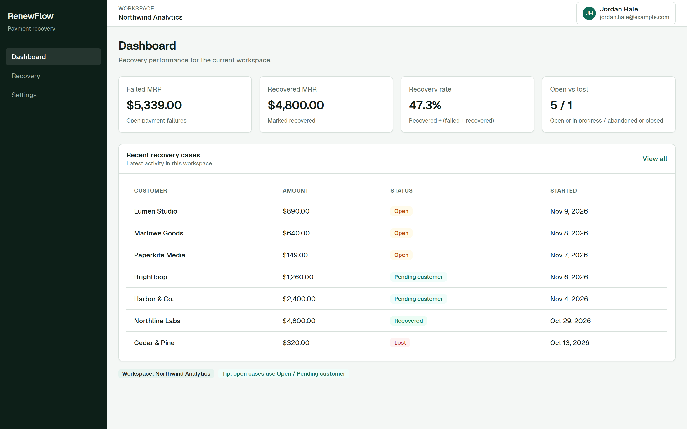
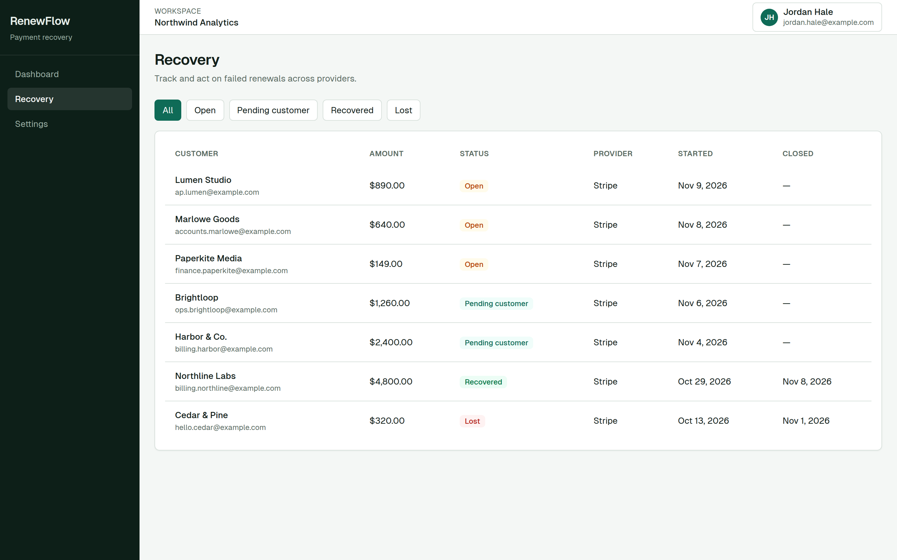
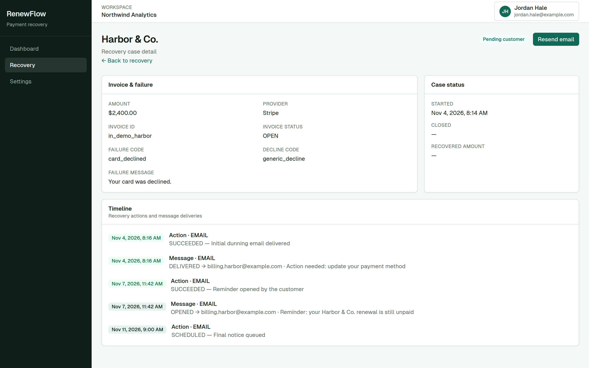
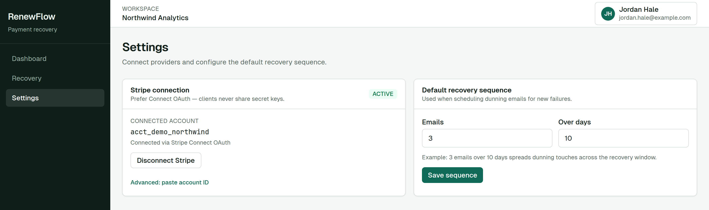
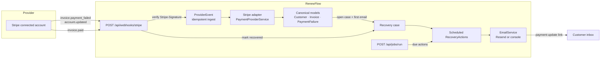

# RenewFlow

Recover failed subscription renewals before they become churn.

[](https://nextjs.org/)
[](https://www.typescriptlang.org/)
[](https://www.prisma.io/)
[](https://stripe.com/connect)

RenewFlow is a multi-tenant recovery console for subscription businesses. When a renewal payment fails, it opens a case and runs an email dunning sequence with a payment-update link, so revenue comes back before the customer quietly cancels.

The product does not use AI. Billing events, cases, and emails are ordinary application code.

## Problem

Card declines, expired cards, and authentication challenges fail renewals that customers still intend to pay. Most of that revenue is recoverable in the first days, and most teams find out too late: the invoice sits past due, the subscription lapses, and the customer is gone.

Generic billing dashboards show the failure. They do not run the follow-up.

## Solution

RenewFlow sits on the billing provider’s webhooks. A failed invoice becomes a workspace-scoped recovery case. A scheduled sequence emails the customer a payment-update link. When the invoice is paid, the case closes and recovered revenue shows up on the dashboard.

Stripe Connect is the first provider. Clients connect their own Stripe account. They never paste a secret key into RenewFlow.

## Screenshots

Demo workspace **Northwind Analytics**, loaded by `npm run db:seed`. Names, emails, and the Stripe account id are fictional. Stripe and Resend are not called to render these screens.









## Key features

- **Workspace tenancy.** Credentials auth (NextAuth), owner-scoped settings, and every query filtered by workspace.
- **Stripe Connect.** OAuth linking, signature-checked webhooks, and idempotent `ProviderEvent` storage so retries do not double-open cases.
- **Recovery cases.** A failed invoice opens one case and schedules the first dunning email. Later paid invoices mark the case recovered.
- **Email dunning.** Workspace settings choose how many emails to send and over how many days. Templates fill customer, amount, and payment-update link.
- **Resend, with a console fallback.** Set `RESEND_API_KEY` to send. Leave it unset and the same `EmailService` logs the message locally.
- **Provider-agnostic core.** Recovery code depends on canonical `Customer`, `Invoice`, and `PaymentFailure` models. Stripe is an adapter. Paddle and GoCardless are stubbed behind the same interface.

## Architecture



1. A connected account emits `invoice.payment_failed` (or a subscription/customer update).
2. `POST /api/webhooks/stripe` reads the raw body, verifies `Stripe-Signature` with `STRIPE_WEBHOOK_SECRET`, and upserts a `ProviderEvent` keyed by the Stripe event id.
3. The Stripe adapter maps the payload onto canonical models. No recovery code imports the Stripe SDK.
4. `createRecoveryCase` opens a case and schedules email actions from the workspace sequence (default: 3 emails over 10 days).
5. `POST /api/jobs/run` (bearer `CRON_SECRET`) executes due actions. `getEmailService()` uses Resend when configured and otherwise logs through `ConsoleEmailService`.
6. `invoice.paid` / `invoice.payment_succeeded` closes the loop and counts the amount as recovered MRR.

The same `PaymentProviderService` interface is what a Paddle or GoCardless adapter implements. Register it in `lib/providers/registry.ts` and add a webhook route that verifies signatures and enqueues the same canonical events.

## Tech stack

| Layer | Choice |
| --- | --- |
| App | Next.js 14 App Router, React 18, TypeScript |
| UI | Tailwind CSS |
| Data | Prisma 7, PostgreSQL |
| Auth | NextAuth credentials, bcrypt |
| Billing | Stripe Connect OAuth, Stripe webhooks |
| Email | Resend, behind an `EmailService` adapter |
| Jobs | `POST /api/jobs/run` for due recovery actions |

## Built with AI

RenewFlow was built end to end by a Grok Bot AI agent team: an assistant and a developer driving Cursor cloud agents. The agents designed the domain model, the provider adapters, the recovery engine, and this UI.

That is how the repository was produced. The running product does not call a model, rank customers, or generate dunning copy. Email bodies are templates.

## Local setup

Requirements: Node.js 20+, PostgreSQL 14+.

```bash
cp .env.example .env
# Set DATABASE_URL, NEXTAUTH_SECRET, and NEXTAUTH_URL.
# Leave Stripe and Resend unset to browse the demo with no external calls.

npm install
npx prisma migrate dev
npm run db:seed
npm run dev
```

App: http://localhost:3000

Demo login after seeding:

| | |
| --- | --- |
| Email | `jordan.hale@example.com` |
| Password | `demo-password` |
| Workspace | Northwind Analytics |

The seed password is for local demo data only. It is not a production credential.

Stripe webhooks, when you do connect a test account:

```bash
stripe listen --forward-to localhost:3000/api/webhooks/stripe
```

In the Dashboard, enable Connect, set the redirect URI to `/api/stripe/connect/callback`, and point a Connect webhook endpoint at `/api/webhooks/stripe`. Clients then use **Settings → Connect with Stripe**. Webhooks resolve the workspace from `event.account`.

## Environment variables

Copy `.env.example`. Placeholders are not live keys.

| Variable | Required | Purpose |
| --- | --- | --- |
| `DATABASE_URL` | Yes | PostgreSQL connection string |
| `NEXTAUTH_SECRET` | Yes | Session signing secret |
| `NEXTAUTH_URL` | Yes | Auth callback base URL |
| `APP_URL` | Recommended | Absolute links in dunning email |
| `NEXT_PUBLIC_APP_URL` | No | Fallback for `APP_URL` |
| `STRIPE_SECRET_KEY` | For live Stripe calls | Platform secret (`sk_test_...` locally) |
| `STRIPE_WEBHOOK_SECRET` | For webhooks | Signature secret (`whsec_...`) |
| `STRIPE_CLIENT_ID` | For Connect OAuth | Connect application id (`ca_...`) |
| `STRIPE_CONNECT_REDIRECT_URI` | No | Defaults to `${APP_URL}/api/stripe/connect/callback` |
| `STRIPE_CONNECT_STATE_SECRET` | No | OAuth state signing; defaults to `NEXTAUTH_SECRET` |
| `RESEND_API_KEY` | No | When unset, email is logged, not sent |
| `EMAIL_FROM` | No | From address for Resend |
| `CRON_SECRET` | In production | Bearer token for `/api/jobs/run` |

`.env`, `.env.*` (except `.env.example`), private keys, and credential dumps are gitignored. Do not commit them.

## Project structure

```
app/
  (app)/dashboard          Recovery metrics
  (app)/recovery           Case list and detail
  (app)/settings           Connect + dunning sequence
  (auth)/login|signup      Credentials auth
  api/webhooks/stripe      Verify, store, ack
  api/stripe/connect       OAuth start and callback
  api/jobs/run             Due recovery actions
components/                App shell, tables, settings forms
lib/providers/             PaymentProviderService + Stripe, Paddle, GoCardless
lib/recovery/              Cases, scheduler, templates, email adapters
lib/actions/               Server actions for auth, settings, resend
prisma/schema.prisma       Canonical billing and recovery model
prisma/seed.mjs            Fictional Northwind Analytics workspace
```

## Roadmap

Grounded in the adapters and actions that are stubbed today:

- Paddle and GoCardless services, then Chargebee, Recurly, Braintree, and Adyen, each behind `PaymentProviderService`
- A public `/pay/update/[token]` page so the dunning link collects a new payment method
- SMS and in-app steps beside email (`RecoveryActionType` already allows them)
- Provider-initiated payment retries, not only customer-updated cards
- Encryption at rest for any integration credentials the adapters do store

## Notable routes

| Path | Role |
| --- | --- |
| `/dashboard` | Failed MRR, recovered MRR, recovery rate, recent cases |
| `/recovery` | Filterable case list |
| `/recovery/[id]` | Invoice, failure, and dunning timeline |
| `/settings` | Stripe connection and default email sequence |
| `POST /api/webhooks/stripe` | Signature check, idempotent event, fast 2xx |
| `POST /api/jobs/run` | Cron for due `RecoveryAction`s |
